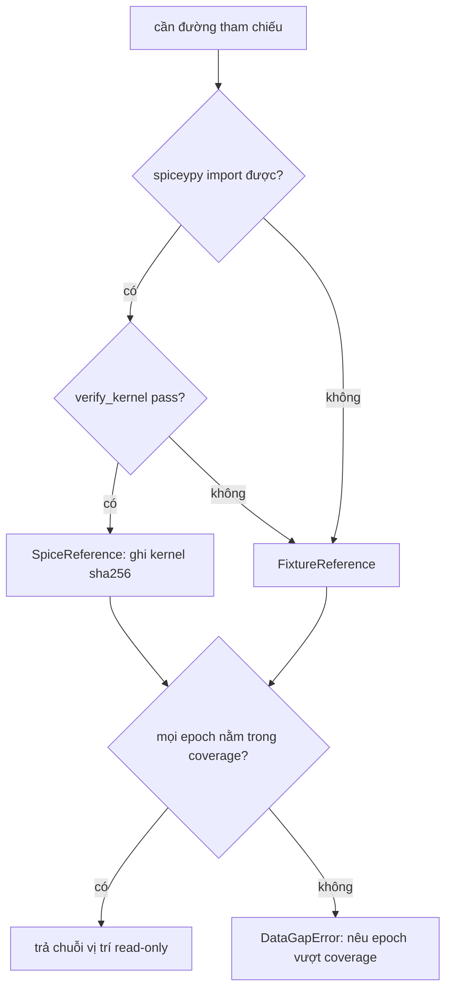

# Phase 6 Scientific Visualization Layer - Plan

## Goal Capsule

- **Objective:** Sau khi triển khai (tương lai, cần phê duyệt riêng), nhà khoa học và reviewer đọc được kết quả Phase 1–5 dưới dạng figure khoa học tĩnh, mỗi figure truy vết được nguồn dữ liệu và provenance đầy đủ, không cần chạy lại bất kỳ tính toán vật lý nào.
- **Means:** Lớp `visualization/` read-only tiêu thụ `results/` đã đóng băng, dựng figure bằng matplotlib (KTD7, KTD11), xuất PNG + sidecar JSON (KTD9) (per Key Decisions KD1–KD3).
- **Authority:** Mạng ưu tiên scientific correctness > data integrity > reproducibility > interpretability > UI polish (R1) — mọi xung đột thiết kế giải quyết theo thứ tự này; các hợp đồng đã đóng băng của Phase 4/5 (`docs/methodology/phase5-results.md`, `results/baseline_frozen.json`, `results/gates_frozen.json`) là sự thật nền.
- **Stop conditions:** Không viết production code trong run thiết kế này; không sửa `results/`, pipeline Phase 4/5, integrator, DE440; không ML, không web dashboard; triển khai chỉ bắt đầu khi người dùng phê duyệt riêng.
- **Execution profile:** Standard depth, markdown, thiết kế trước — triển khai là U1–U6 trong tương lai khi được phê duyệt.
- **Who finishes:** Người viết (run này) giao tài liệu thiết kế; implementer tương lai (U1–U6) ship code + test khi được phê duyệt.

---

## Product Contract

### Summary

Tài liệu này thiết kế lớp trực quan hóa khoa học (Phase 6) cho solar-ephemeris: đọc ghi chú kết quả Phase 1–5 (`results/`) theo kiểu read-only, dựng ~13 figure tĩnh cho 9 chức năng V1–V9, mỗi figure kèm sidecar provenance máy-đọc-được và caption; thiếu dữ liệu thì báo data-gap, không bao giờ chạy lại physics. Triển khai code là việc của run khác, sau phê duyệt.

### Problem Frame

Phase 1–5 đã tạo kho kết quả JSON/NPZ được chấp nhận và đóng băng (Gate A 340, Gate B 26) nhưng dạng dữ liệu thô — reviewer không thể "nhìn" kết quả, chỉ đọc bảng số. Bảng rejected-approaches của Phase 5 (§8 trong `docs/methodology/phase5-experiment-design.md`) cho phép viz "chỉ khi trực tiếp phục vụ một kết quả khoa học đã hoàn thành" — Phase 6 đúng là hoàn cảnh đó: kết quả đã xong, viz đến sau và chỉ được đọc. Rủi ro cần thiết kế trước: figure sai đơn vị/sai khung, figure trộn nguồn tham chiếu, figure tự động chạy lại simulation, hoặc figure không truy vết được — mỗi cái đều phá scientific correctness trước cả aesthetics.

### Key Decisions

- KD1. Tiêu thụ output Phase 1–5 theo read-only, một chiều (session-settled: user-directed — chosen over viewer tự trigger re-run: scientific data flow không đảo chiều) — Governs R2, R3, R14.
- KD2. Static-first; interactive viewer chỉ là wrapper mỏng deferred (session-settled: user-directed — chosen over dashboard-first: ưu tiên reproducibility > polish) — Governs R4, R14.
- KD3. matplotlib là dependency plotting duy nhất mới (session-settled: user-approved — sole new plotting dependency: dự án numpy-only, thêm tối thiểu) — Governs R29.
- KD4. Tài liệu này viết tại `docs/methodology/phase6-visualization-design.md`, tiếng Việt, heading số kiểu Phase 4/5 (user-approved tại scoping confirmation) — Governs R28.
- KD5. Viewer tương tác (nếu có) chỉ gọi cùng bộ `plot_*`, không nhân đôi logic — Governs R30.

### Requirements

**Quy tắc nền**

- R1. Mọi xung đột thiết kế giải quyết theo thứ tự scientific correctness > data integrity > reproducibility > interpretability > UI polish.
- R2. Dòng dữ liệu một chiều: physics → simulation → kết quả ghi lại → visualization; viz không bao giờ trigger tính toán lại, không sửa kết quả.
- R3. Viz chỉ đọc `results/`; dữ liệu thiếu → báo data-gap tường minh, không chạy bù, không lược bỏ im lặng.
- R4. Không ML/AI; không dashboard/web framework mặc định; static-first.
- R5. Figure chỉ được phục vụ kết quả khoa học đã hoàn thành (tương ứng carve-out Phase 5 §8), không mở rộng phạm vi khoa học mới.

**Provenance**

- R6. Mỗi figure có một sidecar JSON máy-đọc-được chứa tối thiểu: `figure_id`, `experiment_id`, `configuration_hash`, `output_hash`, `figure_data_hash`, bodies, epoch, duration, integrator, timestep, frame, origin, time_scale, units, reference_dataset, reference_kernel (kèm sha256 khi có), source (stored|derived|aggregate), gaps[], style_version, software/matplotlib version, generation timestamp — cùng caption chứa các token provenance chính.
- R7. Sidecar ghi theo ngữ nghĩa `write_record`: `sort_keys=True`, `allow_nan=False` — series không hữu hạn không được ghi xuống JSON.
- R8. `figure_data_hash` là SHA-256 trên các mảng dữ liệu vẽ (cùng construction với `output_hash` hiện có — theo byte mảng, không theo file); sha256 của PNG chỉ là thông tin phụ, không dùng làm định danh.
- R9. Record thiếu field provenance (2 record "reused" `results/experiment_D/T2_30d`, `T3_30d`): fallback theo `comparison.model_metadata` và/hoặc record đích `reused_from` (kiểm tra `configuration_hash` khớp trước khi tin), sidecar ghi `provenance_complete: false` kèm danh sách field thiếu.

**Đơn vị & khung tham chiếu**

- R10. Trục vẽ mặc định SI; tùy chọn nhãn AU cho vị trí và km/s cho vận tốc qua helper trong viz, dùng hằng có sẵn `physics.constants.AU_M` và `KM_TO_M`, không gõ lại hằng số.
- R11. Regression test m↔AU và m/s↔km/s kiểm định hai chiều độc lập (hằng vị trí và hằng vận tốc test riêng), đọc từ module hằng nguồn.
- R12. Sidecar/caption luôn mang frame + origin + time_scale + units; figure không bao giờ trộn provenance tham chiếu kernel (DE440) với fixture trong cùng một hình.
- R13. Quy tắc figure khoa học: có nhãn đơn vị trục, giới hạn trục trung thực (không cắt bỏ baseline/tín hiệu), không smoothing, không 3D trang trí gây sai lệch perspective, projection/frame của mọi hình 2D/3D phải được nêu trong caption.

**Plotting API**

- R14. Tám hàm tất định `plot_trajectory`, `plot_model_vs_reference`, `plot_position_error`, `plot_velocity_error`, `plot_conservation`, `plot_convergence`, `plot_body_count`, `plot_horizon_error` — không gọi engine mô phỏng, side-effect chỉ ghi vào đường dẫn khai báo.
- R15. Năm role ngữ nghĩa `model`, `reference`, `error`, `control`, `signal` đông cứng, phân biệt được ở grayscale (đường/vạch/nhãn — không chỉ màu), kèm `style_version`.
- R16. V1 — quỹ đạo 2D qua `plot_trajectory`, caption nêu projection và frame.
- R17. V2 — quỹ đạo 3D tĩnh camera-independent qua `plot_trajectory`, animation deferred.
- R18. V3 — overlay model vs tham chiếu qua `plot_model_vs_reference`, đường tham chiếu lấy từ lookup read-only tại các thời điểm đã ghi (KTD2), không dùng lại số liệu lỗi stored như thể đó là vị trí tham chiếu.
- R19. V4 — chuỗi lỗi vị trí qua `plot_position_error` từ payload comparison đã normalize (KTD10).
- R20. V5 — chuỗi lỗi vận tốc qua `plot_velocity_error`, cùng nguồn với V4.
- R21. V6 — series conservation (năng lượng / động lượng / động lượng góc) qua `plot_conservation`, suy xuất từ `trajectory.npz` bằng `analysis/*`, khai báo `source: derived` trong sidecar.
- R22. V7 — convergence qua `plot_convergence` (A1/A2/B), không xếp hạng "integrator tốt nhất"; mọi so sánh kèm cảnh báo floor-dominated khi số liệu đã kết luận ở Phase 5.
- R23. V8 — ảnh hưởng số body qua `plot_body_count` (tiers + controls của experiment C), role `signal`/`control` đúng bảng style; body chưa có error series → annotation gap, không suy đoán.
- R24. V9 — tăng trưởng lỗi theo horizon qua `plot_horizon_error`; không fitting/khẳng định lớp tăng trưởng khi record không có thống kê phân biệt (record `discriminated: false` → vẽ series + annotation "không phân biệt").
- R25. Bộ figure cụ thể = bảng định danh tại High-Level Technical Design (Fig-01…Fig-13), mỗi figure khai nguồn dữ liệu + variant record + trạng thái kernel.
- R26. Ma trận nguồn dữ liệu figure × artifact (cùng HTD) là bắt buộc: stored comparison > aggregate JSON > suy xuất read-only (khai báo) > data-gap; không figure nào tự chọn nguồn khác ma trận.

**Kiểm chứng & hợp đồng tài liệu**

- R27. Contract test cấm viz thực thi simulation, theo mẫu AST của `tests/unit/test_import_boundaries.py` (KTD3).
- R28. Doc-contract test cho chính tài liệu này: heading bắt buộc + token V1–V9 + 8 tên `plot_*` + hằng đóng băng, theo mẫu `tests/unit/test_phase4_doc_contract.py`.
- R29. Gate A (pytest mặc định, kernel-free) luôn xanh trên máy chưa cài matplotlib; test render dùng `importorskip`, test dữ liệu ghi chạy trong Gate A, test đọc record thật đánh dấu/deselect kiểu `real_kernel` (KTD11).
- R30. Quy tắc normalize comparison, redirect `reused_from`, và data-gap được test bằng đúng một record mẫu mỗi hình dạng (flat / per-body / absent / reused) từ `results/` thật.

### Acceptance Examples

- AE1. Với `results/experiment_E/horizon_1d` và không có kernel: `plot_model_vs_reference` trả figure V3 + sidecar ghi provider fixture, coverage −1d…+10d, `reference_kernel: fixture`, gaps rỗng. Covers R18, R6.
- AE2. Với `results/experiment_E/horizon_365d` và không có kernel: nhận `DataGapError` mang report máy-đọc-được, không ghi PNG, report nêu rõ epoch vượt coverage fixture. Covers R3, R27.
- AE3. Với `results/experiment_D/T2_30d`: reader redirect sang `experiment_C/tier_T2` sau khi xác nhận `configuration_hash` khớp; figure và sidecar ghi rõ chuỗi `reused_from`. Covers R9, R30.
- AE4. Với `results/experiment_E/horizon_365d` (kernel có sẵn): V9 vẽ đủ series và annotation "không phân biệt — chỉ report", không in lớp tăng trưởng. Covers R24.

### Scope Boundaries

**Outside this product's identity (không bao giờ làm):**

- ML/AI, model fitting tự học, "best integrator" ranking.
- Web dashboard, Streamlit/React/Plotly-dashboard/WebGL, animation-first output.
- Sửa physics, integrator, pipeline DE440, bất kỳ byte nào trong `results/` đã đóng băng; chạy lại experiment để phục vụ figure.
- Website thiên văn chung chung ngoài 9 chức năng V1–V9.

**Deferred to Follow-Up Work:**

- Triển khai U1–U6 (code + test) — chờ phê duyệt riêng sau tài liệu này.
- Interactive viewer mỏng (KD5) — deferred, chỉ gọi lại cùng API tĩnh.
- Tái tạo figure định kỳ tự động (regeneration CI) và styling xuất bản journal.

### Sources / Research

- `tests/unit/test_import_boundaries.py` — mẫu AST scan + subprocess check mà R27/KTD3 nhân rộng.
- `tests/unit/test_experiment_contract.py`, `tests/unit/test_phase4_doc_contract.py` — mẫu contract test hai chiều code↔doc (R28) và shim `sys.path` cho gói `experiments/` cấp root.
- `experiments/_common.py` — `output_hash`, `experiment_record()`, `write_record` (`sort_keys=True`, `allow_nan=False`), hằng lưới đóng băng (`N_VALUES`, `A2_DIVISORS`, `E_HORIZON_DAYS`, `TIERS`) — nguồn của R7/R8 và bảng composition (KTD8).
- `src/solar_ephemeris/ephemeris/reference.py` (`get_state` + gate thứ tự), `ephemeris/comparison.py` (`compare_trajectory`, `assert_compatible`) — đường lookup read-only cho V3 (KTD2/KTD6).
- `src/solar_ephemeris/physics/constants.py` (`AU_M = 149597870700.0`), `ephemeris/units.py` (`KM_TO_M`) — nguồn hằng cho R10/R11.
- `src/solar_ephemeris/analysis/__init__.py` — bề mặt hàm suy xuất cho V6 (`total_energy`, `momentum_series`, `angular_momentum_series`, …), tất cả nhận `Trajectory` chứ không nhận đường dẫn file.
- `docs/methodology/phase5-results.md`, `docs/methodology/phase5-experiment-design.md` §8 — kết quả đã chấp nhận và điều kiện cho phép viz Phase 6.
- `results/` — kiểm kê thật: hai biến thể record (full §6d vs reduced reused), ba hình dạng comparison (flat / per-body / absent), `trajectory.npz` vắng mặt đúng ở `experiment_D/T2_30d|T3_30d`.

---

## Planning Contract

### Key Technical Decisions

- KTD1. Ma trận nguồn dữ liệu: ưu tiên stored comparison (đã normalize) → aggregate JSON (`*_orders.json`, `analysis.json`, `*_summary.json`, `baseline_frozen.json`) → suy xuất read-only từ `trajectory.npz` + provider/analysis (sidecar ghi `source: derived`) → data-gap; mỗi figure đi theo đúng một nhánh khai báo trong ma trận HTD. Không bake-off: phía ưu tiên do spec (không tính lại, một chiều) và bằng chứng record trong repo ấn định sẵn.
- KTD2. V3 lấy chuỗi vị trí tham chiếu bằng một helper read-only **mới, cộng dồn** bên cạnh `compare_trajectory` trong `src/solar_ephemeris/ephemeris/`, tái sử dụng đúng thứ tự per-sample + `assert_compatible` — không mở rộng `ComparisonResult` vì sẽ làm rung chuyển schema record đã cam kết (vi phạm R2).
- KTD3. Hợp đồng "không thực thi simulation" mang tính **hành vi**: AST scan cấm viz import/nstantiate `SimulationEngine`, gọi `.run(`/`.propagate(`, `run_to_file`, `run_reproducible`, `experiments.run_phase5`; viz **được** import `simulation.engine` (chỉ `Trajectory` dataclass), `ephemeris`, `analysis` — vì 5/7 module `analysis/` hard-import `Trajectory` ở module scope, cấm tuyệt đối sẽ tự thà chính nó.
- KTD4. Thêm loader read-only công khai `load_trajectory_npz()` (npz + `traj_meta_json`, chịu được thiếu `run_record.json`) trong `src/solar_ephemeris/simulation/runner.py`; viz chỉ dùng loader này, không với vào `_traj_meta_from_json` riêng tư.
- KTD5. Hợp đồng data-gap terminal: thiếu dữ liệu → exception typed `DataGapError` mang report máy-đọc-được (cùng schema với `gaps[]` của sidecar); figure phát hành được thì phải có `gaps[]` (rỗng hoặc có nội dung); figure đa-panel vẽ phần khả dụng kèm annotation gap; không bao giờ cắt cụt một chuỗi lỗi/tăng trưởng (cắt cụt là một khẳng định khoa học).
- KTD6. Chọn provider theo thứ tự: `SpiceReference` khi `spiceypy` import được **và** `verify_kernel` pass → ngược lại `FixtureReference`; coverage không đủ mọi mẫu → nguyên figure thành data-gap (không vẽ prefix); một figure không trộn lỗi stored (kernel) với chuỗi suy xuất (fixture).
- KTD7. Tất định: ghim phạm vi `matplotlib` trong extra `viz`, cố định rcParams/DPI/kích thước/font (một style module duy nhất), `figure_data_hash` trên mảng vẽ là định danh chính, `matplotlib.__version__` + sha256 PNG ghi thêm thông tin.
- KTD8. Composition registry cho V7/V8/V9 (grid n-values, divisor, tiers+controls, horizons — V6 một trajectory.npz nên không cần run-set) là **bảng trong tài liệu này**, contract-test đối chiếu với hằng `experiments/_common.py` (mẫu code↔doc của Phase 5); đọc `growth_classification` từ record E, không tái lập fit; mọi tái lập (nếu sau này cần) phải kèm test equality với record.
- KTD9. Ghi figure: xuất ra cây `figures/` **ngoài** `results/` (evidence tree bất biến), sidecar ghi trước/th_rename atomic với PNG, trùng tên → ghi đè deterministic cùng `figure_id`; series không hữu hạn → `DataGapError` **trước** khi ghi PNG (không bao giờ partial: PNG không sidecar).
- KTD10. Normalize comparison: `"position_error" in comparison` → flat single-body, wrap thành `{comparison["body"]: payload}`; còn lại → body map; vắng `comparison` → tính theo figure (re-derive nếu KTD6 cho phép, không thì gap).
- KTD11. Chiến lược matplotlib: extra optional `viz` (mẫu extra `spice`), test render `pytest.importorskip("matplotlib")`, test logic thuần chạy trong Gate A không cần matplotlib, một smoke test đọc record thật đánh dấu/deselect kiểu `real_kernel` — Gate A giữ nguyên thuộc tính "xanh anywhere".

### High-Level Technical Design

Dòng dữ liệu một chiều, mọi nhánh bất thường kết thúc ở data-gap:

```mermaid
flowchart TB
  P[Physics / integrators] --> S[simulation chạy experiment]
  S --> R["results/ (đóng băng: records + npz)"]
  R --> L[loader read-only KTD4]
  L --> N[normalize record + comparison KTD10]
  N --> D{cần suy xuất thêm?}
  D -- stored đủ --> G[ghép series]
  D -- V3/V6/V7/V9 --> X["lookup read-only (KTD2/KTD6) + analysis/*"]
  X --> G
  D -- thiếu --> GAP[DataGapError + gaps[] KTD5]
  G --> ST[style roles + units KTD7 / R10-R15]
  ST --> F["8 plot_* tất định (R14)"]
  F --> O["figures/ PNG + sidecar.json (KTD9)"]
  GAP -.-> O
```

Chọn provider cho V3 (nhánh quyết định duy nhất chạm runtime bên ngoài):



Tám hàm API (hợp đồng chữ ký — sematics chi tiết ở Requirements):

| Hàm | Feature | Nguồn chính |
|---|---|---|
| `plot_trajectory` | V1 (2D), V2 (3D) | `trajectory.npz` |
| `plot_model_vs_reference` | V3 | npz + lookup read-only |
| `plot_position_error` | V4 | comparison stored (KTD10) |
| `plot_velocity_error` | V5 | comparison stored (KTD10) |
| `plot_conservation` | V6 | npz + `analysis/*` (derived) |
| `plot_convergence` | V7 | aggregate `*_orders.json` + records |
| `plot_body_count` | V8 | records C + `analysis.json` |
| `plot_horizon_error` | V9 | comparison E + `growth_classification` |

Ma trận nguồn dữ liệu figure × artifact:

| Feature | Record full §6d | Record reused (D 30d) | Record không comparison (A1/B) | Aggregate JSON |
|---|---|---|---|---|
| V1/V2 | npz trực tiếp | redirect `reused_from` → npz đích | npz trực tiếp | — |
| V3 | lookup read-only (KTD6) | redirect rồi lookup | lookup read-only | — |
| V4/V5 | payload stored (normalize) | payload stored từ record đích | re-derive nếu coverage đủ, không thì gap | — |
| V6 | npz + analysis (derived) | redirect rồi derived | npz + analysis (derived) | — |
| V7 | — | — | — | `*_orders.json`, `analysis.json` |
| V8 | payload stored + signals | payload stored từ record đích | — | `analysis.json` (signal/control) |
| V9 | payload stored + growth_class | payload stored từ record đích | — | — |

Bảng style role đông cứng (grayscale-safe, `style_version` ghi vào sidecar):

| Role | Kiểu đường | Marker | Vai trò trong hình |
|---|---|---|---|
| `model` | đặc, dày | tròn rỗng | kết quả tích phân của ta |
| `reference` | chấm-ghép | — | DE440/fixture |
| `error` | đặc, mảnh | vuông | chuỗi lỗi / sai số |
| `control` | gạch ngắn | tam giác | đường điều khiển (C controls) |
| `signal` | chấm | chéo | tín hiệu khoa học cần thấy (C signals) |

Bộ figure cụ thể (mẫu tối thiểu cho kết quả đã chấp nhận):

| # | Figure | V | Nguồn | Trạng thái |
|---|---|---|---|---|
| Fig-01 | Quỹ đạo hệ trong SSB-ICRS (XY, AU) | V1 | `results/experiment_C/tier_T*` | kernel-agnostic |
| Fig-02 | Zoom quỹ đạo Đất–Trăng | V1 | `results/experiment_C/tier_T2` | kernel-agnostic |
| Fig-03 | Bố cục 3D tĩnh 10 body | V2 | `results/experiment_C/tier_T4` | kernel-agnostic |
| Fig-04 | Model vs DE440 (Đất) | V3 | `results/experiment_C/tier_T2` + kernel | cần kernel |
| Fig-05 | Model vs fixture (V3 kernel-free) | V3 | `results/experiment_E/horizon_1d` | kernel-free |
| Fig-06 | Lỗi vị trí theo thời gian (formal D 7d) | V4 | `results/experiment_D/T{1,2}_7d` | stored |
| Fig-07 | Lỗi vị trí per-body theo tier (+gap 8 body) | V4 | `results/experiment_C/tier_T*` | stored |
| Fig-08 | Lỗi vận tốc per-body | V5 | `results/experiment_C/tier_T*` | stored |
| Fig-09 | Conservation: năng lượng/động lượng/động lượng góc | V6 | `results/experiment_C/tier_T2` npz (derived) | derived |
| Fig-10 | Convergence A1: lỗi cuối vs N + observed orders + floor | V7 | `results/experiment_A1/*` + `*_orders.json` | aggregate |
| Fig-11 | A2 divisor ratios + B ref-lattice (cảnh báo floor-dominated) | V7 | `results/experiment_A2/analysis.json`, `results/experiment_B/ref_summary.json` | aggregate |
| Fig-12 | Ảnh hưởng số body (signal vs control) | V8 | `results/experiment_C/*` + `analysis.json` | stored |
| Fig-13 | Lỗi theo horizon 1/30/90/365d + annotation phân biệt | V9 | `results/experiment_E/horizon_*` | stored |

Bảng composition cho V7/V8/V9 (KTD8 — đối chiếu với hằng `experiments/_common.py`):

| Feature | Run-set | Hằng nguồn |
|---|---|---|
| V7 (A1) | n ∈ {25, 50, 100, 200} × {RK4, Verlet} | `N_VALUES` |
| V7 (A2) | divisor ∈ {500, 1000, 2000, 4000} | `A2_DIVISORS` |
| V8 | tiers T1–T4 + `control_T2_dt2`, `control_T3_dt2` | `TIERS` + record controls |
| V9 | horizons {1, 30, 90, 365} d | `E_HORIZON_DAYS` |

V6 không cần run-set: mỗi figure lấy một `trajectory.npz` (Fig-09).

### Output Structure

Thư mục mới khi triển khai (không có trong run thiết kế này):

```text
src/solar_ephemeris/visualization/
  __init__.py
  loader.py        # bọc load_trajectory_npz (KTD4)
  normalize.py     # variant record + comparison shape (KTD10)
  gaps.py          # DataGapError + schema gaps[] (KTD5)
  provenance.py    # sidecar, figure_data_hash, ghi atomic (R6-R9, KTD9)
  style.py         # bảng role + rcParams ghim (R15, KTD7)
  units.py         # helper hiển thị, reuse hằng nguồn (R10-R11)
  providers.py     # chính sách chọn provider V3 (KTD6)
  composition.py   # bảng run-set V7/V8/V9 (KTD8)
  api.py           # 8 plot_* (R14)
figures/           # output — ngoài results/
tests/unit/test_viz_import_boundary.py
tests/unit/test_viz_data.py
tests/unit/test_viz_reference.py
tests/unit/test_viz_provenance.py
tests/unit/test_viz_api_single_run.py
tests/unit/test_viz_api_multi_run.py
tests/unit/test_phase6_doc_contract.py
tests/real_kernel/test_viz_reference.py
```

### Assumptions

- Bảng V1–V9 suy từ spec (spec gửi dừng ở §14) và khớp đúng 8 hàm `plot_*`; nếu danh sách V chính thức khác, sửa Requirements R16–R24 và bảng HTD tương ứng.
- 15 câu hỏi flow (data-source matrix, V3 reference-series API, provider, data-gap, determinism, V9 gate, composition, matplotlib/test strategy, sidecar/output, normalize, enforcement, provenance fallback, display units, doc contract, wrapper) đều lấy default có bằng chứng từ research — không câu nào blocking; nếu bạn muốn đổi câu nào, đổi tại đây trước khi triển khai.
- Fixture coverage −1d…+10d quanh J2000 và `kernels/de440s.bsp` hiện có trên máy này — hai điều kiện này quyết định trạng thái kernel-free/kernel của Fig-04 vs Fig-05.
- Triển khai U1–U6 cần phê duyệt riêng; tài liệu này không cấp thẩm quyền chạy code.

### Sequencing

U1 → U2 → (U3, U4 song song) → U5 → U6; U3/U4 không phụ thuộc nhau nhưng đều cần U2. Chi tiết phụ thuộc trong từng unit.

---

## Implementation Units

### U1. Scaffold gói visualization + import-boundary contract

- **Goal:** Tạo khung package, extra dependency, và hợp đồng "viz không thực thi simulation" được kiểm bằng AST ngay từ đầu.
- **Requirements:** R4, R27, R28, R29 (governed bởi KD1, KD3).
- **Dependencies:** —
- **Files:** `src/solar_ephemeris/visualization/__init__.py`, `pyproject.toml`, `tests/unit/test_viz_import_boundary.py`, `tests/unit/test_phase6_doc_contract.py`.
- **Approach:**
  1. Thêm extra `viz` (matplotlib, phạm vi version ghim chặt hơn core) song song extra `spice` hiện có; không đưa vào core deps.
  2. Viết AST test theo đúng cấu trúc `tests/unit/test_import_boundaries.py`: quét cây `visualization/`, cấm các token thực thi (per KTD3), khai báo allow-list import.
  3. Doc-contract test theo mẫu `tests/unit/test_phase4_doc_contract.py`: REQUIRED_HEADINGS + token V1–V9 + 8 tên `plot_*` + hằng `149597870700`.
- **Execution note:** Viết hai contract test đỏ trước, mới scaffold package (test-first cho boundary).
- **Test scenarios:**
  - Happy: import `solar_ephemeris.visualization` thành công và AST scan pass trên code sạch.
  - Error: một fileviz giả tạo trong fixture cài `SimulationEngine` hoặc gọi `run_to_file` → AST test đỏ.
  - Edge: Gate A trên môi trường không có matplotlib vẫn xanh (test này không import matplotlib).
  - Doc-contract: bỏ một token `V9` khỏi tài liệu → test đỏ.
  - Error: file viz import `torch`/`sklearn`/`streamlit` → AST test đỏ (R4: không ML, không dashboard).
- **Verification:** `python -m pytest tests/unit/test_viz_import_boundary.py tests/unit/test_phase6_doc_contract.py` xanh; Gate A tổng không đổi số xanh hiện có.

### U2. Data layer read-only: loader, normalize, data-gap

- **Goal:** Mọi đường dẫn đọc `results/` đi qua một lớp duy nhất chịu được 4 hình dạng record và trả về DataGapError thay vì im lặng.
- **Requirements:** R3, R5, R9, R14, R30; KTD4, KTD5, KTD10.
- **Dependencies:** U1.
- **Files:** `src/solar_ephemeris/simulation/runner.py` (thêm `load_trajectory_npz`), `src/solar_ephemeris/visualization/{loader,normalize,gaps}.py`, `tests/unit/test_viz_data.py`.
- **Approach:**
  1. `load_trajectory_npz` đọc npz + `traj_meta_json`, không yêu cầu `run_record.json`; tái dựng `Trajectory` qua dataclass hiện có.
  2. Reader nuốt cả hai biến thể record; record reused redirect theo `reused_from` sau khi đối chiếu `configuration_hash`.
  3. Normalize theo KTD10; schema `gaps[]` = `{name, reason, detail, source_path}` khớp ngữ nghĩa `gate()` của `_common.py`.
  4. Toàn bộ đọc bằng fixture JSON/NPZ **synthetic nhỏ** cho test Gate A; một smoke test record thật đánh dấu kiểu `real_kernel`.
- **Test scenarios:**
  - Happy: load npz đầy đủ → `Trajectory` đúng shape `(M,N,3)`, `body_names` khớp.
  - Happy: normalize flat (`results/experiment_A2/d1000`) → map 1 body; per-body (`results/experiment_C/tier_T2`) → map 2 body.
  - Edge: record reused `results/experiment_D/T2_30d` → redirect đúng đích, `reused_from` nằm trong result.
  - Error: redirect đích thiếu hoặc `configuration_hash` không khớp → `DataGapError` chứa report, không exception thô.
  - Error: thiếu `trajectory.npz` không có `reused_from` → `DataGapError`.
  - Edge: record vắng `comparison` (`results/experiment_B/one_period_rk4`) → trả cờ absent cho caller theo ma trận, không tự quyết.
  - Error: loader từ chối nguồn ngoài `results/` (R5: chỉ phục vụ kết quả đã hoàn thành).
- **Verification:** smoke test record thật (đánh dấu) đọc được 4 mẫu: flat, per-body, absent, reused.

### U3. Lookup tham chiếu read-only + chính sách provider (nền V3)

- **Goal:** Cung cấp chuỗi vị trí tham chiếu cho V3 mà không đụng schema record và không vi phạm gate.
- **Requirements:** R18, R12, R27; KTD2, KTD6.
- **Dependencies:** U2.
- **Files:** `src/solar_ephemeris/ephemeris/reference.py` (helper series read-only), `src/solar_ephemeris/visualization/providers.py`, `tests/unit/test_viz_reference.py` + cases trong `tests/real_kernel/`.
- **Approach:**
  1. Helper cộng dồn cạnh `compare_trajectory`: nhận provider + danh sách epoch đã ghi, tái sử dụng thứ tự gate và `assert_compatible` hiện có.
  2. `providers.py` cài chính sách KTD6 (chọn provider, kiểm coverage toàn bộ mẫu, trả `DataGapError` khi thiếu).
  3. Sidecar ghi identity provider: `kernel_sha256` (Spice) hoặc id fixture + coverage.
- **Test scenarios:**
  - Happy: với fixture, lookup phủ toàn bộ epoch trong `results/experiment_E/horizon_1d` → chuỗi vị trí, metadata fixture đầy đủ.
  - Error: fixture với epoch `results/experiment_E/horizon_30d` → `DataGapError` nêu epoch vượt coverage, không trả prefix.
  - Integration (real_kernel): SpiceReference trên `results/experiment_C/tier_T2` (30d, vượt coverage fixture) → chuỗi vị trí + sha256 kernel khớp manifest.
  - Edge (R12): một figure chỉ mang một identity tham chiếu — sidecar V3 ghi fixture **hoặc** sha256 kernel, không bao giờ cả hai.
  - Edge: `spiceypy` không import được → rơi xuống fixture tự động, không raise ImportError thô.
- **Verification:** 3/4 nhánh provider có test xanh; nhánh kernel chỉ chạy trong Gate B.

### U4. Provenance sidecar + nền tất định (style/units/render)

- **Goal:** Mỗi figure đi qua một pipeline render duy nhất: style role ghim, units từ hằng nguồn, sidecar ghi atomic, hash xác định.
- **Requirements:** R6, R7, R8, R10, R11, R13, R15; KTD7, KTD9.
- **Dependencies:** U2.
- **Files:** `src/solar_ephemeris/visualization/{provenance,style,units}.py`, `tests/unit/test_viz_provenance.py`.
- **Approach:**
  1. `provenance.py`: build sidecar theo R6, ghi temp → rename cùng PNG, từ chối non-finite trước khi render (R7/KTD9).
  2. `figure_data_hash` tái dùng chính construction `output_hash` (name + shape + bytes).
  3. `style.py`: bảng role kiểu HTD + `style_version`; rcParams/DPI/font cố định tại một chỗ.
  4. `units.py`: helper m/AU, m/s/km/s nhận hằng từ `physics.constants` và `ephemeris.units`.
- **Test scenarios:**
  - Happy: sidecar xuất xanh chứa đủ mọi key R6 (assert theo danh sách token).
  - Edge: series chứa NaN → `DataGapError` trước, không tồn tại PNG mồ côi (kiểm bằng danh sách file output).
  - Happy: render hai lần cùng mảng → `figure_data_hash` bằng nhau, PNG sha256 (nếu khác) không làm fail.
  - Error: `allow_nan=False` không bao giờ raise khi sidecar ghi hợp lệ.
  - Integration: `AU_M` và `KM_TO_M` assert bằng đúng hằng từ module nguồn, hai test độc lập (R11).
  - Edge: role `signal` phân biệt được khi render grayscale (kiểm tra linestyle/marker của artist, không kiểm màu RGB).
- **Verification:** `python -m pytest tests/unit/test_viz_provenance.py` xanh; chạy lại hai lần → sidecar `figure_data_hash` ổn định.

### U5. V1–V5: bộ figure single-run

- **Goal:** 5 tính năng đầu hoạt động trên một record, đúng hợp đồng caption/provenance.
- **Requirements:** R16–R20, R13, R25 (Fig-01…Fig-08), R14.
- **Dependencies:** U2, U3, U4.
- **Files:** `src/solar_ephemeris/visualization/api.py` (5 hàm đầu), `tests/unit/test_viz_api_single_run.py`.
- **Approach:**
  1. Cài `plot_trajectory` (mode 2D/3D — projection/frame vào caption), `plot_model_vs_reference`, `plot_position_error`, `plot_velocity_error` theo đúng thứ tự pipe của U2–U4.
  2. Đăng ký Fig-01…Fig-08 vào registry (id, nguồn, variant) khớp bảng HTD.
- **Test scenarios:**
  - Happy: render V4 từ record flat và record per-body → PNG + sidecar `source: stored`.
  - Happy: V1 caption chứa token frame + projection (R13).
  - Edge: V3 kernel-free (Fig-05) → sidecar `reference_kernel: fixture`.
  - Error: V3 với horizon vượt fixture → `DataGapError` đúng schema (AE2).
  - Integration: Fig-07 render với annotation gap cho 8 body thiếu error series.
  - Happy: registry chứa Fig-01…Fig-08 khớp bảng HTD và mọi nguồn nằm trong ma trận nguồn (R25, R26).
  - Edge: trục V4 bao phủ toàn bộ dữ liệu (không cắt baseline) — assert xlim/ylim bao trùm min/max của series (R13).
- **Verification:** các test render chạy xanh khi matplotlib có mặt; Gate A không có matplotlib vẫn xanh.

### U6. V6–V9: bộ figure multi-run + composition registry

- **Goal:** 4 tính năng đa-run hoạt động theo composition table đã contract-test, không bao giờ khẳng định điều số liệu không phân biệt.
- **Requirements:** R21–R26 (Fig-09…Fig-13), R27.
- **Dependencies:** U2, U4 (U3 không bắt buộc — V6–V9 không cần lookup).
- **Files:** `src/solar_ephemeris/visualization/api.py` (4 hàm còn lại), `src/solar_ephemeris/visualization/composition.py`, `tests/unit/test_viz_api_multi_run.py`.
- **Approach:**
  1. `composition.py` chứa bảng run-set (theo KTD8); test đối chiếu với hằng `experiments/_common.py` qua shim `sys.path` (mẫu `test_experiment_contract`).
  2. `plot_conservation` lấy series từ `analysis/*`, sidecar ghi `source: derived`.
  3. `plot_convergence` đọc aggregate, vẽ floor line, không xếp hạng (R22).
  4. `plot_horizon_error` đọc `growth_classification` từ record; `discriminated: false` → annotation bắt buộc.
  5. Thành viên run-set thiếu → panel gap (KTD5), figure vẫn phát hành có `gaps[]`.
- **Test scenarios:**
  - Happy: composition table khớp toàn bộ hằng `_common` (N_VALUES, A2_DIVISORS, E_HORIZON_DAYS, TIERS).
  - Happy: V6 sidecar ghi `source: derived` và trỏ `output_hash` record nguồn.
  - Edge: V9 với `results/experiment_E/horizon_365d` → annotation "không phân biệt" xuất hiện trên figure/sidecar (AE4).
  - Error: V7 thiếu một n-value trong run-set → `gaps[]` có entry, không exception.
  - Integration: V8 với tier 10 body → annotation gap cho 8 body không có stored error (R23).
  - Happy: registry chứa Fig-09…Fig-13 khớp bảng HTD và mọi nguồn nằm trong ma trận nguồn (R25, R26).
- **Verification:** `python -m pytest` toàn Gate A xanh; Gate B (real_kernel) giữ 26+ case xanh.

---

## Verification Contract

| Cổng | Lệnh | Điều kiện |
|---|---|---|
| Gate A (mặc định) | `python -m pytest` từ gốc `solar-ephemeris/` | luôn xanh, kernel-free, không yêu cầu matplotlib |
| Gate B (kernel thật) | `python -m pytest -m real_kernel` | 26 case hiện hữu + test viz kernel của U3 |
| Contract doc | `python -m pytest tests/unit/test_phase6_doc_contract.py` | token V1–V9, 8 `plot_*`, heading, hằng số |
| Contract import | `python -m pytest tests/unit/test_viz_import_boundary.py` | AST: viz không thực thi simulation |
| Determinism | chạy test provenance hai lần | `figure_data_hash` ổn định |

Bản đồ requirement → test (mẫu Phase 4/5):

| R | Test module |
|---|---|
| R1 (design rule — mạng ưu tiên) | `tests/unit/test_phase6_doc_contract.py` (token được giữ trong doc) |
| R2, R4, R14, R27 | `tests/unit/test_viz_import_boundary.py` (AST: cấm thực thi simulation, cấm import ML/web-framework) |
| R3, R5 | `tests/unit/test_viz_data.py` (DataGapError, nguồn chỉ trong `results/`) |
| R6–R9 | `tests/unit/test_viz_provenance.py` |
| R10–R11 | `tests/unit/test_viz_provenance.py` (units) |
| R12 | `tests/unit/test_viz_reference.py` (một figure một identity tham chiếu) |
| R13, R15 | `tests/unit/test_viz_provenance.py` + `tests/unit/test_viz_api_single_run.py` (units/limits, role grayscale) |
| R16–R20 | `tests/unit/test_viz_api_single_run.py` |
| R21–R24 | `tests/unit/test_viz_api_multi_run.py` |
| R25, R26 | `tests/unit/test_viz_api_single_run.py` + `tests/unit/test_viz_api_multi_run.py` (registry khớp HTD, nguồn trong ma trận) |
| R28 | `tests/unit/test_phase6_doc_contract.py` |
| R29 | Gate A xanh không matplotlib (`importorskip` + boundary test không import matplotlib) |
| R30 | `tests/unit/test_viz_data.py` |

---

## Definition of Done

- Toàn bộ R1–R30 có test đối ứng trong bản đồ ở Verification Contract (R1 là design rule được giữ bằng doc-contract); Gate A và Gate B xanh.
- Cây `results/` bất biến: không file nào bị sửa trong suốt run triển khai (kiểm bằng hash cũ của record sources).
- Render hai lần cùng input → `figure_data_hash` giống nhau; mọi figure phát hành có sidecar đủ key R6 và caption có token provenance.
- Contract test AST chặn được regression "viz gọi simulation" (test đỏ khi cài một lối đi cố ý).
- Cleanup: không để lại stub, helper chết, hoặc experiment script ngoài kế hoạch trong diff.
